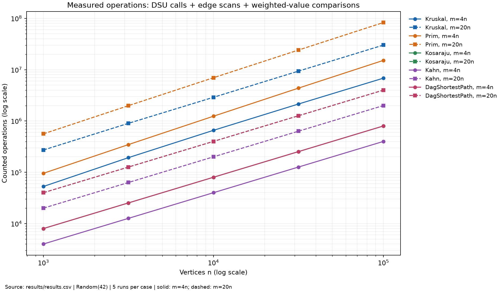
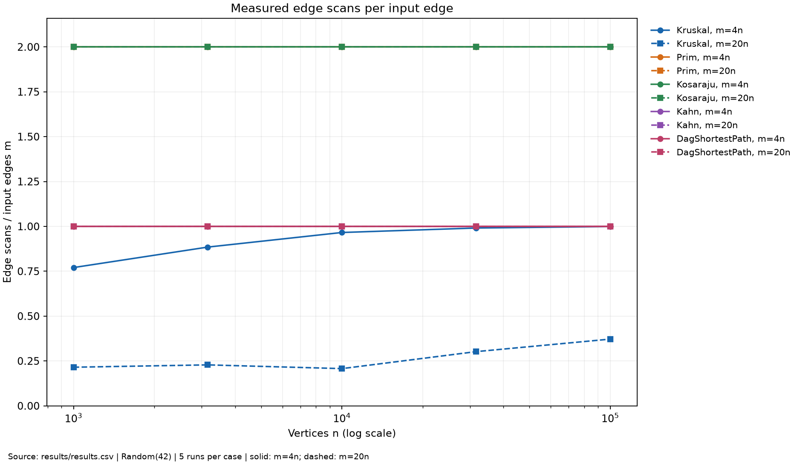
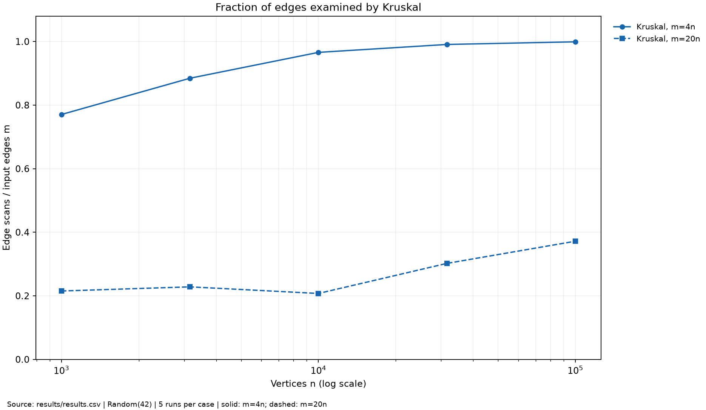

# DAA Assignment 3 - Graphs
Assylzhan Amangeldi | 23 October 2026 | Group: SE-2526

## 1. Design and complexity (page 1 of 5)
The implementation uses one adjacency-list Graph, integer edge weights, long totals and counters. V is the vertex count and E is the input edge count. Undirected adjacency stores two arcs per input edge. Extra space below excludes the original graph but includes working output. Empty graphs, loops, parallel edges and isolates are supported.

| Operation | Time | Extra space | Reason |
|---|---|---|---|
| DSU makeSet | O(V) | O(V) | Initialize parent and size arrays. |
| DSU find / union | O(alpha(V)) amortized | O(1) per call, O(V) stored DSU | Compression plus union by size bounds a sequence of operations; an individual find is not necessarily constant. |
| Kruskal | O(V + E log(E+1) + E alpha(V)) | O(V+E) | Sort an edge copy; scan with DSU, stopping after V-1 selected edges if connected. |
| Prim (lazy edge heap) | O(V + E log(E+1)) | O(V+E) | Scan every adjacency arc; heap may hold O(E) edges, including parallel edges. |
| Kosaraju | O(V+E) | O(V+E) | Two explicit traversals, finish order, component array and transpose. |
| Kahn | O(V+E) | O(V) | Prepare indegrees then remove each vertex and decrement each outgoing arc once. |
| DAG shortest paths | O(V+E) | O(V) | Kahn preparation plus one relaxation pass, distances and parents. |
| Tarjan SCC | O(V+E) | O(V) | One DFS with index/lowlink, explicit frames and active vertices. |
| Condensation | O(V+E) | O(V+E) | Compute SCCs, then retain crossing edges in a new DAG. |
| Critical path on a DAG | O(V+E) | O(V) | Topological maximum relaxation and parent reconstruction. |

### Correctness: cut property
Take a cut separating vertices in an undirected component and choose a minimum-weight crossing edge e. If a spanning tree already contains e, keeping e causes no problem. Otherwise adding e creates a cycle with a crossing edge f whose weight is at least the weight of e. Removing f leaves a spanning tree with no larger weight, so some minimum spanning tree contains e. Kruskal applies this exchange argument to the cut around a current DSU component when it accepts the next lightest edge joining different components. Prim applies it to the cut between its visited tree and unvisited vertices; restarting on another component therefore gives a minimum spanning forest.

### Correctness: topological induction
Every zero-indegree vertex has distance zero, equivalent to an incoming zero-cost edge from a virtual source. Every non-source vertex of a finite DAG is reachable from at least one such source. Assume all vertices before u in a topological order already have optimal distances. Every path to u ends at a predecessor that occurs earlier, so its last edge has already been relaxed. Thus u has its optimum distance when processed, and relaxing its outgoing edges preserves the induction. Negative edges are safe because no cycle can improve a processed vertex; in a general graph negative cycles can make distances undefined, although negative edges without such cycles are valid for algorithms such as Bellman-Ford.

## 2. Reproducible evidence and algorithm choice (page 2 of 5)
Each size/density combination uses a fresh Java Random(42) for each of undirected, directed and DAG graphs. Sizes are 1000, 3162, 10000, 31623, 100000; densities are E=4V and E=20V. Fisher-Yates and endpoint/weight draws follow the assignment in order, retaining parallel edges. Every algorithm runs five times with fresh Metrics. CSV time is the median of these five observations; generation and reference checks are outside the measured algorithm interval. All 50 output results match the assignment reference table, including all MST weights, SCC counts and DAG distance sums. The detailed 50-row instruction takes precedence over the contradictory deliverables phrase "four generated graphs".

Counter boundaries are explicit: dsu_ops counts find calls plus successful unions; edge_scans counts algorithm edge examinations. Kruskal counts sorted-edge examinations, Prim counts adjacency arcs (2E), Kosaraju counts the two DFS passes (2E) but excludes constructing the transpose, Kahn counts removal-phase outgoing arcs (E) but excludes indegree preparation, and DAG counts relaxation arcs (E) but excludes Kahn preprocessing. Comparisons count the sorting/heap comparator calls and DAG distance-candidate comparisons; zero in unweighted traversals means no weighted comparison is performed. max_depth is the maximum number of explicit pending stack entries, including DFS frames in the first pass. These counters describe selected work, not every machine instruction or the full preprocessing cost.

| Situation | Choice and reason |
|---|---|
| Sparse undirected graph already as edge list | Kruskal: simple sort plus DSU and no separate priority frontier. |
| Undirected graph already as adjacency list | Prim: natural frontier expansion; this implementation uses a lazy edge heap. |
| Dense undirected graph | Compare both measured heap/sort counts; a matrix O(V^2) Prim variant can suit truly dense simple graphs, but is not implemented here. E=20V is the assignment's "dense" case, still asymptotically sparse. |
| Directed graph with possible cycles | Kosaraju finds mutually reachable groups; Kahn reports whether a topological order exists. |
| Known DAG with negative weights | Kahn order then DAG relaxation, linear time; all indegree-zero vertices act as sources. |
| General directed weighted graph | These DAG paths do not apply if cyclic; Bellman-Ford handles negative edges and detects reachable negative cycles. |

Tests cross-check DSU labels, 100 connected MST graphs, random SCCs against all-source BFS, DAG distances against Bellman-Ford with negative edges, and a 100000-vertex SCC path. The tests load all three input fixtures.

<!-- MEASUREMENTS_START -->
Sizes in every row below: 1000, 3162, 10000, 31623, 100000.

| Algorithm / density | Counter / formula at the five sizes |
|---|---|
| Kruskal, 4V: comparisons/(E log2 E) | 0.891, 0.907, 0.869, 0.809, 0.745 |
| Kruskal, 20V: comparisons/(E log2 E) | 0.903, 0.846, 0.784, 0.720, 0.666 |
| Prim, 4V: comparisons/(E log2 E) | 1.829, 1.865, 1.895, 1.921, 1.934 |
| Prim, 20V: comparisons/(E log2 E) | 1.825, 1.847, 1.866, 1.878, 1.890 |
| Kosaraju, 4V: scans/(V+E) | 1.600, 1.600, 1.600, 1.600, 1.600 |
| Kosaraju, 20V: scans/(V+E) | 1.905, 1.905, 1.905, 1.905, 1.905 |
| Kahn, 4V: scans/(V+E) | 0.800, 0.800, 0.800, 0.800, 0.800 |
| Kahn, 20V: scans/(V+E) | 0.952, 0.952, 0.952, 0.952, 0.952 |
| DagShortestPath, 4V: scans/(V+E) | 0.800, 0.800, 0.800, 0.800, 0.800 |
| DagShortestPath, 20V: scans/(V+E) | 0.952, 0.952, 0.952, 0.952, 0.952 |

Traversal ratios are exactly constant. Sorting/heap ratios stay bounded in a narrow band, consistent with E log E work; finite experiments support rather than prove an asymptotic bound. Kruskal DSU work depends on the stopping point, so dsu_ops/E need not be constant.
<!-- MEASUREMENTS_END -->

## 3. Counted operation growth (page 3 of 5)

Operations here means dsu_ops + edge_scans + comparisons; max_depth is a space indicator and is not added. Each algorithm has both density series. Kosaraju and DAG curves overlap because each records 2E operations by this definition, though their algorithms do different work. Counters omit some preparation by design, so equal curves do not mean equal total runtime.

## 4. Scans per edge (page 4 of 5)

Prim and Kosaraju scan 2E, Kahn and DAG relaxation E; both densities overlap exactly for these algorithms. A flat scan curve confirms linear scanning, but alone cannot prove the total algorithm complexity. Prim still performs heap comparisons and Kruskal sorts all input edges.

<!-- SLOPES_START -->
| Algorithm | Scan slope, E=4V | Scan slope, E=20V |
|---|---:|---:|
| Kruskal | 1.0550 | 1.1194 |
| Prim | 1.0000 | 1.0000 |
| Kosaraju | 1.0000 | 1.0000 |
| Kahn | 1.0000 | 1.0000 |
| DagShortestPath | 1.0000 | 1.0000 |

OLS fits use natural logs of the five measured points. The PDF incorrectly attributes the sorting log factor to Kruskal edgeScans: sorting comparisons carry that factor, not scans. Kruskal comparison slopes are 1.0545 (4V) and 1.0159 (20V). Its scan slopes reflect the changing fraction before early termination and are not evidence of an E log E scan bound.
<!-- SLOPES_END -->

## 5. Kruskal fraction and timings (page 5 of 5)

Kruskal can stop after V-1 accepted edges on a connected graph. On a forest it processes all necessary sorted edges and reports component count. A smaller fraction of scanned edges in E=20V does not eliminate sorting all E edges. Prim scans all 2E adjacency arcs and also skips stale heap entries. These facts explain the measured operation differences without making a hardware-independent speed claim.

<!-- TIMING_START -->
Recorded median times range from 0.212 to 1972.055 ms on Windows with OpenJDK 25, one JVM and a 4 GiB maximum heap. Timing includes each algorithm's preparation (including DAG topological sorting), while scan counters use the stated narrower boundaries. The two smallest cases are strongly affected by JIT warmup, allocation and background activity; no dedicated warmup was performed. Hardware, JVM and load change timings, whereas operation counts remain reproducible. Therefore conclusions use counters, not a universal speed ranking.
<!-- TIMING_END -->

The source CSV is results/results.csv. Run python scripts/analyze.py to validate coverage and recompute slopes; python scripts/plot.py recreates the three figures directly from that CSV.

## Bonus algorithms
Tarjan uses a single iterative DFS and scans E directed edges, versus 2E DFS scans for Kosaraju. Actual five-run comparisons for all ten size/density cases are in [BONUS.md](BONUS.md) and results/bonus-scc.csv. The bonus also constructs the SCC condensation and finds its longest source-to-sink path by topological maximum relaxation. Crossing edge weights are retained; SCC blocks have zero duration and internal weights are excluded. This is a path through components, not a longest simple path in the original cyclic graph. [BONUS.md](BONUS.md) defines signed-weight behavior, scheduling assumptions and restoration of the component path.
